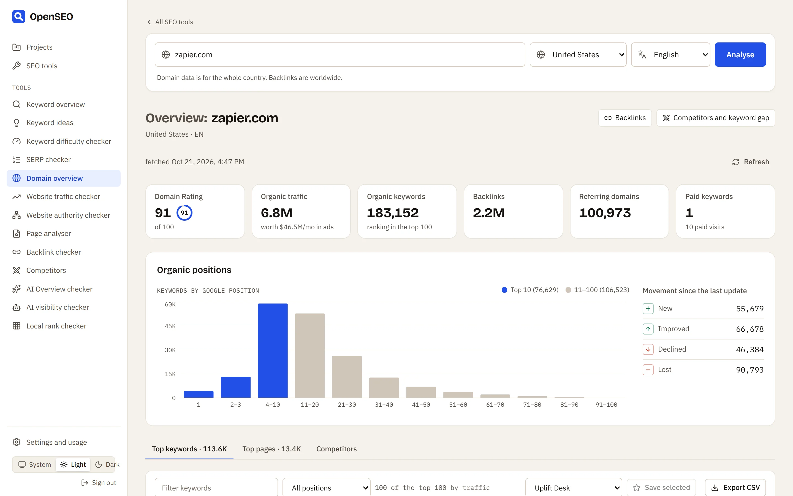

<p align="center">
  <a href="https://openseo.gg"></a>
</p>

<p align="center">
  <a href="LICENSE"></a>
  <a href="#-self-host-with-docker"></a>
  <a href="https://openseo.gg/docs/mcp"></a>
  <a href="https://openseo.gg"></a>
</p>

<p align="center">
  
  
  
  
  
  
</p>

<h3 align="center">
  <a href="https://openseo.gg">Website</a>
  &nbsp;·&nbsp;
  <a href="https://openseo.gg/docs">Docs</a>
  &nbsp;·&nbsp;
  <a href="https://openseo.gg/docs/self-hosting">Self-hosting</a>
  &nbsp;·&nbsp;
  <a href="https://openseo.gg/docs/mcp">Connect an agent</a>
  &nbsp;·&nbsp;
  <a href="https://openseo.gg/docs/rest-api">REST API</a>
  &nbsp;·&nbsp;
  <a href="https://openseo.gg/tools">SEO tools</a>
</h3>

<br>

**OpenSEO** is a user-first, open-source SEO tool suite for everyone. It covers keyword research, rank tracking, backlinks, site audits and AI visibility, and reads your own Google Search Console and Analytics data. Run it on your own machine or server, read every line of it, and hand it to your AI agent.

> [!NOTE]
> OpenSEO is early and in active development. [Issues](https://github.com/duckduckdeploy/openseo/issues) and ideas are very welcome.

<p align="center">
  <picture>
    <source media="(prefers-color-scheme: dark)" srcset="apps/web/public/screens/keyword-overview-dark.webp">
    
  </picture>
</p>

## 📸 A look inside

Every tool is one search: type a keyword, domain or URL, pick a country (and a city or state where it helps), press Enter, and everything loads together. The search is in the address, so any view can be bookmarked or shared. Each tool has [its own page](https://openseo.gg/tools), and [the guide](https://openseo.gg/docs/tutorials/seo-tools) goes through every screen.

<table>
  <tr>
    <td width="50%"><br><sub><b>SERP checker</b>: the live top 10 with SERP features in place and each page's DR, links and traffic</sub></td>
    <td width="50%"><br><sub><b>Domain overview</b>: traffic, keywords, links, rankings, top keywords and pages</sub></td>
  </tr>
  <tr>
    <td width="50%"><br><sub><b>Backlinks</b>: totals, monthly history, strongest links, anchors and link intersect</sub></td>
    <td width="50%"><br><sub><b>Competitors</b>: who you compete with, and the keyword gap with any of them</sub></td>
  </tr>
</table>

## ✨ Why OpenSEO

- 🔓 **Open source, all of it.** The app, the API, the crawler and the agent server are MIT licensed. Change what you need and keep your changes.
- 🏠 **Your server, your data.** One Docker command runs the whole suite on your own computer or server. Your keywords, rankings and audits stay in your own database.
- 💸 **No surprise bills.** Every action shows its cost before it runs, and a monthly limit stops all spending once it is reached.
- 🤖 **Agents on a leash.** 66 MCP tools cover the whole workspace. Every paid tool takes `dry_run` and `max_cost_usd`, so an agent cannot spend more than you agreed.
- 📈 **Your own Google data.** Connect Search Console and GA4 read-only. You get queries one push from page one, and pages scored by where improving them is most worth it.
- 🎯 **Focused workflows.** The SEO work most sites actually do, without the hundred reports nobody opens.

## 🧰 Workflows

| Area | What you get |
|---|---|
| 🔎 [Keyword overview](https://openseo.gg/tools/keyword-overview) | Difficulty, volume, traffic potential, volume by country, ideas and the live top 10 for one keyword, down to a city |
| 💡 [Keyword ideas](https://openseo.gg/tools/keyword-ideas) | Matching terms, related searches, questions and suggestions with volume, CPC, difficulty, intent and trend; saved lists with tags |
| 📋 [SERP checker](https://openseo.gg/tools/serp-checker) | The live top 10 on desktop or mobile, with each result's DR, UR, links and traffic |
| 📍 Rank tracking | Google positions on desktop and mobile, by country, city or exact coordinates, on a schedule. Every check reads the top 100, in the background on a schedule or on demand. History survives removing a keyword |
| 📊 Search performance | Search Console and GA4: totals against the previous period, striking-distance queries, organic landing pages, opportunity scores |
| 🌐 [Domain overview](https://openseo.gg/tools/domain-overview) | Estimated traffic, ranking distribution, top keywords, top pages, competitors |
| 📄 [Page analyser](https://openseo.gg/tools/page-analyser) | One page's authority, links, traffic, on-page checks, keywords and backlinks |
| 🔗 [Backlink checker](https://openseo.gg/tools/backlink-checker) | Summary, monthly history, backlinks, referring domains, anchors, top pages, link intersect |
| 🥊 [Competitors](https://openseo.gg/tools/competitors) | Organic and SERP competitors, keyword gap |
| 🩺 Site audit | Our own crawler with 59 checks and a health score; Lighthouse with failed audits rated by severity |
| 🧠 AI visibility | Tracked prompts across many chat models with web search: mentions, citations, position, share of voice. Prompts that name your brand are left out of the rates |
| 🗺️ Local SEO | Business lookup, profile, reviews, geo-grid rank maps |

## 🐳 Self-host with Docker

You need [Docker](https://docs.docker.com/get-docker/). On Windows or macOS that's Docker Desktop with at least 4 GB of memory.

```bash
git clone https://github.com/duckduckdeploy/openseo.git openseo
cd openseo
cp .env.example .env
# In .env, set AUTH_SECRET (32+ random characters)
# and ENCRYPTION_KEY (openssl rand -base64 32)
docker compose up -d --build
```

| Service | Address |
|---|---|
| Dashboard | http://localhost:3200 |
| Site and docs | http://localhost:3101 |
| API and MCP | http://localhost:4100 (`/api/*`, `/mcp`) |

One image runs everything: Postgres, the API with its MCP server and background worker, the dashboard and the site. Database migrations run when the API starts.

**On a cloud server with your own domain**, add HTTPS with automatic Let's Encrypt certificates:

1. Point your domain, `app.` and `api.` at the server.
2. Set `OPENSEO_DOMAIN`, `APP_URL`, `WEB_URL`, `PUBLIC_API_URL` and `POSTGRES_PASSWORD` in `.env`.
3. Run `docker compose --profile https up -d --build`.

The [self-hosting guide](https://openseo.gg/docs/self-hosting) covers servers, updates, backups and every setting.

## 🤖 Connect your AI agent

**ChatGPT and Claude (web and desktop):** add a custom connector with the URL `{API_URL}/mcp` and OAuth sign-in. You sign in with your OpenSEO account and approve; no key needed. Connected apps can be revoked in Settings.

For other agents, create an API key under Settings and store it in an environment variable named `OPENSEO_API_KEY`.

**The quick way:** copy the setup prompt from Settings and paste it into your agent. The agent connects itself and checks the connection with free calls only.

**Claude Code:** install the plugin, which bundles the connection and the skills:

```bash
/plugin install openseo --marketplace duckduckdeploy/openseo
```

Set `OPENSEO_MCP_URL` to point it at a self-hosted install.

**Any other MCP client:** add `{API_URL}/mcp` with the header `Authorization: Bearer <key>`. The [MCP guide](https://openseo.gg/docs/mcp) has the exact config for:

- Claude Code and Claude Desktop
- Cursor
- VS Code
- Codex
- Gemini CLI
- OpenCode
- Windsurf

### 🧩 Skills

Ready-made SEO workflows in [`plugins/openseo/skills`](plugins/openseo/skills), built on the 66 MCP tools:

| Skill | What it does |
|---|---|
| [`seo-coach`](plugins/openseo/skills/seo-coach/SKILL.md) | Learn SEO on your own site, and pick the first thing worth doing |
| [`seo-audit`](plugins/openseo/skills/seo-audit/SKILL.md) | The one or two fixes most likely to bring more traffic |
| [`keyword-research`](plugins/openseo/skills/keyword-research/SKILL.md) | Topics worth writing about, grouped and saved |
| [`competitor-analysis`](plugins/openseo/skills/competitor-analysis/SKILL.md) | Their strategy, the keyword gap, and where you can win |
| [`search-console-review`](plugins/openseo/skills/search-console-review/SKILL.md) | Quick wins from your own Google data, free |
| [`local-seo`](plugins/openseo/skills/local-seo/SKILL.md) | Your Maps profile, reviews and rankings street by street |

Every skill prices paid steps with `dry_run` first and passes the limit you agree as `max_cost_usd`. Or just ask, for example "which of my pages are stuck on page two?". The same features are available over the [REST API](https://openseo.gg/docs/rest-api).

## 🔎 Search data

The crawler, site audit and Google data are free. Keyword volumes, rankings, backlinks and other search data come from [YepAPI](https://yepapi.com?ref=openseo). You add your own key when you set up your account, and each lookup is billed to it at the price the app shows first: a page-one rank check costs $0.01, and 150 keyword ideas cost about $0.08.

## 🛠️ Development

Requirements: Node 22+, pnpm 10, Postgres 15+ (or `docker compose up -d postgres`).

```bash
pnpm install
pnpm db:migrate
pnpm dev                 # API :4100, dashboard :3200, site :3101, with live reload
pnpm typecheck
pnpm test
```

The tests need no database, network or API keys. `apps/api/test` runs the real API against an in-memory Postgres (PGlite) with the real migrations, plus stand-ins for the data provider (`apps/api/src/testing/fake-yepapi.ts`) and Google (`apps/api/src/testing/fake-google.ts`). For local work without a data key, run the stand-in with `pnpm --filter @openseo/api fake-yepapi` and set `YEPAPI_BASE_URL=http://localhost:4199`.

```
apps/api          Fastify API, MCP server, background worker (pg-boss)
apps/app          Dashboard (Next.js)
apps/web          Public site and docs (Next.js)
packages/yepapi   Typed data client with price estimates
packages/crawler  Site-audit crawler
packages/shared   Model catalog and shared helpers
```

User documentation and tutorials live on the site under `/docs` (`apps/web/src/app/docs`).

## 🔐 Security

- Stored data keys and Google tokens are encrypted at rest with AES-256-GCM (`ENCRYPTION_KEY`) and never returned by the API.
- API keys are stored as SHA-256 hashes and shown once.
- OAuth for MCP clients:
  - dynamic client registration and PKCE (S256)
  - exact redirect URIs
  - single-use codes
  - access tokens that last one hour
  - rotating refresh tokens; a reused one ends the grant
  - tokens stored as hashes
- Paid lookups are not retried after a server error or a lost connection, since they may already have been billed.
- The crawler refuses private, loopback and metadata addresses, including through redirects.
- In Docker, the app, site and API listen only on the machine itself. The optional Caddy service is the only thing facing the internet.

## 🤝 Contributing

Clear [issues](https://github.com/duckduckdeploy/openseo/issues) are the most useful contribution: what you did, what you expected and what happened. For code, run `pnpm typecheck` and `pnpm test` before opening a pull request.

## 📄 Licence

[MIT](LICENSE). Use it, change it, host it.

<p align="center"><sub>Made in the open · <a href="https://openseo.gg">openseo.gg</a> · <a href="https://github.com/duckduckdeploy/openseo">⭐ Star on GitHub</a></sub></p>
